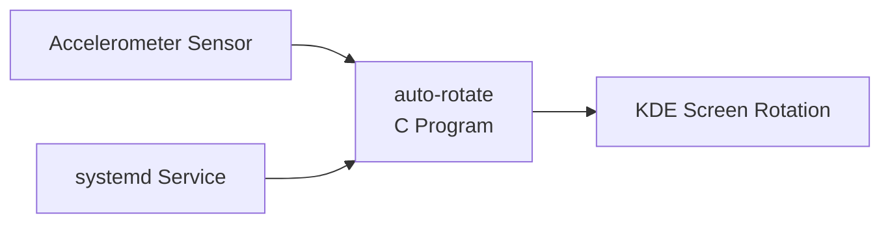

  

    

  <b>Auto-rotate screen utility for KDE on Linux</b>

---

## 🐧 Overview

A C program and systemd service that auto-rotates the screen on KDE based on the laptop's physical orientation, using sensor data (accelerometer) and GLib/GIO.

---

## 🛠️ How It Works

---

## 🚀 Tech Stack

   

---

  

